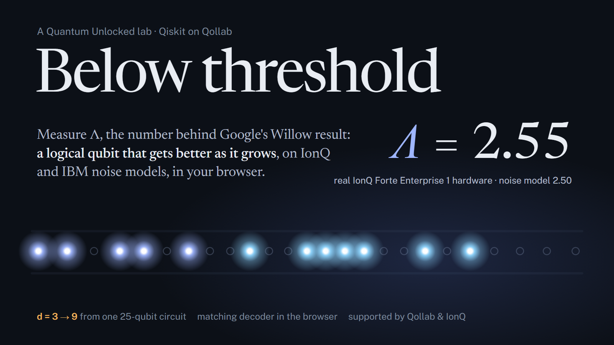

<p align="center"></p>

# Below threshold

**[Run it on Qollab](https://qollab.xyz/u/master/below-threshold)** · **[Demo video](https://youtu.be/aKLjxx0HDAQ)** · **[How it works](#what-happens-in-one-run)** · **[Results](#results)** · MIT


**Reproduce the result behind Google's Willow chip, a logical qubit that gets better as it grows, on whichever machine you pick in Qollab's runner.**

Press **Run**, pick a machine (an IonQ trapped-ion noise model, one of IBM's eight superconducting noise models, or an ideal simulator), then press **Run the experiment** on the page. One job later you have the number the field is built on: **Λ**, the factor by which each step up in code size divides the logical error. Every number is computed in your browser from the shots the machine returned.

This effort is supported by Qollab & IonQ.

<a id="results"></a>

| Machine (noise model, dial at 6%) | Kind | Qubits | Shots | Λ fitted over all distances | 95% interval |
|---|---|---|---|---|---|
| IonQ Forte 1 | trapped ions | 25 | 1,600 | **2.78** | 2.37 – 3.27 |
| IonQ Aria 2 | trapped ions | 19 | 1,600 | **2.63** | 2.26 – 3.31 |
| IonQ Forte Enterprise 1 | trapped ions | 25 | 3,200 (2 runs) | **2.47** | 2.29 – 2.75 |
| IonQ Aria 1 | trapped ions | 19 | 1,600 | **2.46** | 2.10 – 3.11 |
| IonQ Forte Enterprise 1, **twirling off** | trapped ions | 25 | 1,600 | **1.97** | 1.73 – 2.12 |
| IBM Kingston | superconducting | 17 | 1,600 | **2.87** | 2.44 – 3.53 |
| IBM Fez | superconducting | 17 | 1,600 | **2.71** | 2.29 – 3.17 |
| IBM Boston | superconducting | 17 | 1,600 | **2.64** | 2.13 – 2.88 |
| IBM Aachen | superconducting | 17 | 1,600 | **2.43** | 1.98 – 2.59 |
| IBM Pittsburgh | superconducting | 17 | 1,600 | **2.23** | 1.97 – 2.55 |
| IBM Miami | superconducting | 17 | 1,600 | **2.13** | 1.88 – 2.34 |
| IBM Berlin | superconducting | 17 | 1,600 | **2.12** | 1.82 – 2.24 |
| IBM Marrakesh | superconducting | 17 | 1,600 | **1.97** | 1.85 – 2.21 |
| Built-in simulator | no noise | 19 | 1,600 | **2.94** | 2.36 – 3.77 |
| AWS Braket local simulator | no noise | 19 | 1,600 | **2.49** | 1.95 – 2.96 |
| *Google Willow, surface code (2024)* | superconducting | 101 | | *2.14* | ± 0.02 |
| *Google Sycamore, repetition code (2021)* | superconducting | 21 | | *2.99* | ± 0.09 |

With the dial at 6%, every machine lands between Λ ≈ 2.0 and 2.9, and each machine's own noise moves it a little. Turning twirling off on IonQ Forte Enterprise 1 drops Λ from 2.47 to 1.97: coherent errors add up and the decoder, which expects random flips, loses ground. A third independent Forte Enterprise run, launched from the page itself, gave Λ = 2.20.

---

## Why this exists

Quantum error correction only pays off **below threshold**: when the hardware is good enough that a bigger code makes a better qubit. Proving it took Google from 2021 (repetition codes) to 2024 (Willow's surface code, Λ = 2.14). The tools that teach it today are either theory courses, click-a-lattice toys with no circuits, or expert software (Stim, PyMatching) that doesn't run in a browser.

Below threshold closes that gap. In one page, with nothing to install, anyone can:

1. run a real repetition-code memory experiment on a real device's noise model, trapped ions or superconducting;
2. watch their own shots become detection events, and the matching decoder explain them;
3. try to decode a shot themselves and compare with the decoder;
4. measure Λ with honest error bars and place it next to Google's numbers;
5. learn the machine's own noise from its syndromes, the way Google calibrates its decoders;
6. see why coherent errors are worse than random ones, and how twirling fixes them.

## How to run it

1. Open the project and press **Run**.
2. In **Select QPU**, pick any simulator. The IonQ noise models (Forte Enterprise 1, Forte 1, Aria 1, Aria 2) are free and run on IonQ's cloud. The IBM noise models and the ideal simulators run in your browser.
3. The page appears above the console, showing a run recorded on that machine. Set the **noise dial** and **shots**, then press **Run the experiment**.
4. IonQ machines take one job per run, so press **Stop**, then **Run**, to send another. Each finished run is also saved in the console as a JSON file you can download.

Typical times: about 2.5 minutes on IonQ Forte models (1,600 shots of a 25-qubit circuit), under a minute on the built-in simulator, and a few minutes on the IBM noise models (every shot is simulated in your browser).

## What happens in one run

**One circuit holds every code size.** IonQ's runners on Qollab accept a single circuit per job. So the lab builds the largest repetition code that fits (distance 9, 25 qubits, on the IonQ models) and reads the smaller codes out of it. Any `d` neighbouring data qubits and the checks between them form a complete distance-`d` memory with the same noise. Google compared distance-3 corners of its distance-5 surface code the same way (Nature 614, 676, 2023). The distance-9 code holds seven distance-3s, five distance-5s and three distance-7s. Rates use every window, while error bars count only non-overlapping windows.

**Syndromes without mid-circuit measurement.** Qollab's IonQ path measures once, at the end. Every round therefore gets fresh ancillas, read at the end: an ancilla that is never touched again gives the same statistics whether it is read now or later (deferred measurement). That costs `d + r(d-1)` qubits, so 25 for d = 9 with r = 2 rounds. On IBM's noise models the ancillas are measured and reset every round, as on real superconducting chips, and the code is laid along a line of neighbouring qubits, so it needs no SWAPs. The Nighthawk models have no reset instruction, so there the ancillas keep their last reading, and each round's syndrome is the XOR of two consecutive readings.

**The noise dial, twirled.** Every machine here is far below this code's threshold, so failures at d ≥ 5 would be too rare to count. The dial adds `RX(θ)` with $\sin^2(\theta/2) = q$ on every data qubit before each round and on every ancilla before readout. A coherent rotation is not a random flip, because amplitudes add up before they are squared (about 30% more failures at d = 3). So every rotation gets a random sign ($Z\,RX(\theta)\,Z = RX(-\theta)$), which is Pauli twirling, also called randomized compiling. Averaged over copies, it is exactly the random-flip channel the decoder assumes; the lab tests this against Qiskit Aer.

**Decoding.** The lab lists every single fault of the circuit and the detection events it causes. This detector error model is what Stim computes, written out by hand here so it runs in Pyodide. Edges are weighted $\ln\frac{1-p}{p}$. Minimum-weight perfect matching uses an exact subset dynamic program (networkx blossom above 16 events). Majority vote is the classical baseline. Each distinct bitstring is decoded once.

**Λ.** Failures per shot become an error per round,

$$\varepsilon = \tfrac12\left[1 - (1-2P_L)^{1/r}\right],$$

as in Google's 2021 paper. Λ between neighbouring distances is $\varepsilon_d/\varepsilon_{d+2}$, and the headline Λ is fitted across all distances from $\varepsilon_d = C/\Lambda^{(d+1)/2}$. Intervals come from 2,000 parametric bootstrap resamples, and Wilson intervals are shown per distance.

**Calibration from syndromes.** Two detectors that share an error mechanism fire together more often than chance:

$$p_{ij} = \tfrac12 - \tfrac12\sqrt{1 - \frac{4\left(\langle x_ix_j\rangle - \langle x_i\rangle\langle x_j\rangle\right)}{1 - 2\langle x_i\rangle - 2\langle x_j\rangle + 4\langle x_ix_j\rangle}}$$

The lab learns every edge of the graph from your shots and shows how much noise the machine adds on top of the dial. It then decodes again with the learned weights.

## The page

| Figure | What it shows |
|---|---|
| 1. Bigger code, smaller error | ε per round against distance, matching versus majority vote, the model's prediction, and Λ on a ruler next to Willow and Google 2021 |
| 2. One shot, from ions to answer | real shots drawn as an ion-camera frame (bright = 1, dark = 0, false colour for the 369.5 nm light), then the decoding graph with the matching drawn on it |
| 3. Be the decoder | pair up detection events yourself and play against the matching decoder |
| 4. The machine, measured from its own syndromes | learned error rates for each kind of mechanism, next to the dial alone and the published specs |
| 5. Where the threshold is | the crossing of the d = 3, 5, 7 curves when rounds grow with distance (about 13% for this circuit) |
| 6. The same experiment on every machine | Λ with intervals for every machine recorded on Qollab |
| 7. Coherent errors add up | the same machine with and without twirling, against the model |

## Fork it

The lab is built to be extended:

- **A different code.** `lab/code.py` builds the circuit and `lab/dem.py` enumerates its faults. Any code whose single faults flip at most two detectors (the phase-flip code, a surface code's X or Z half) decodes with the same matcher.
- **A different decoder.** `lab/decode.py` takes a list of weighted edges. Swap in union-find, or a decoder that uses the calibrated weights (`lab/calibrate.py`) by default.
- **Real hardware.** Pick an IonQ quantum computer in Qollab's dialog; the page runs unchanged. Keep the shot count under 500 so IonQ's debiasing stays off and the failure statistics stay raw.
- **Teaching.** Every figure reads from one JSON run, so a class can share runs (the console saves each one) and compare machines.

## Honest limits

- **Bit flips only.** A repetition code ignores phase errors, so its Λ is not a surface-code Λ. It shows the mechanism, not a full logical qubit.
- **The dial does the heavy lifting.** With native noise alone, distance 5 fails about once in 10,000 shots on these machines.
- **Two rounds.** Google fitted up to 50. With r = 2, ε still carries some of the start and end of the memory.
- **Noise models are models.** IonQ says its noise-model simulators should not be used to predict hardware results.
- **One circuit on IonQ.** The IonQ runs use one twirled copy of the circuit, since a job holds one circuit. Local runs average four copies.

## Files

```
index.html, main.css, main.js   the page (Qollab JS project)
ui/                              figures: charts, ion camera and graph, game, atlas
lab/code.py                      circuits: unrolled and reuse layouts, the twirled dial, windows
lab/dem.py                       detector error model by fault enumeration
lab/decode.py                    exact MWPM and majority vote
lab/stats.py                     Wilson intervals, ε per round, Λ fit and bootstrap
lab/calibrate.py                 edge probabilities learned from detector correlations
lab/experiment.py                one job on the chosen machine, windowed decoding, analysis
lab/web.py                       what the page calls; recorded runs and predictions
lab/game.py                      puzzles for "Be the decoder"
data/theory.json                 predictions from the same error model, 20,000 shots per point
data/atlas.json                  runs recorded on Qollab's machines
tests/                           20 checks against Qiskit Aer (not needed on Qollab)
```

Tests (local Python with `qiskit`, `qiskit-aer`, `networkx`): `python -m pytest tests -q`. They check that windows decode like standalone codes, that the twirled dial matches the model on Aer, that coherent rotations are worse, that single faults are always corrected, and that the exact matcher agrees with blossom.

## Built for the Qollab x IonQ hackathon

Everything here was written during the build window (October 10–12, 2026), with no earlier code: the lab, the decoders, the page, the recorded runs and the tests. Theme: **Quantum Unlocked**, teaching a hard topic interactively.

## References

1. Google Quantum AI, "Exponential suppression of bit or phase errors with cyclic error correction", *Nature* 595, 383 (2021).
2. Google Quantum AI, "Suppressing quantum errors by scaling a surface code logical qubit", *Nature* 614, 676 (2023).
3. Google Quantum AI, "Quantum error correction below the surface code threshold", *Nature* 638, 920 (2025).
4. Egan et al., "Fault-tolerant control of an error-corrected qubit", *Nature* 598, 281 (2021).
5. Higgott & Gidney, "Sparse Blossom", arXiv:2303.15933. Gidney, "Stim", *Quantum* 5, 497 (2021).
6. Bravyi et al., "Correcting coherent errors with surface codes", *npj Quantum Information* 4, 55 (2018). Wallman & Emerson, "Noise tailoring for scalable quantum computation via randomized compiling", *PRA* 94, 052325 (2016).

MIT licence.
